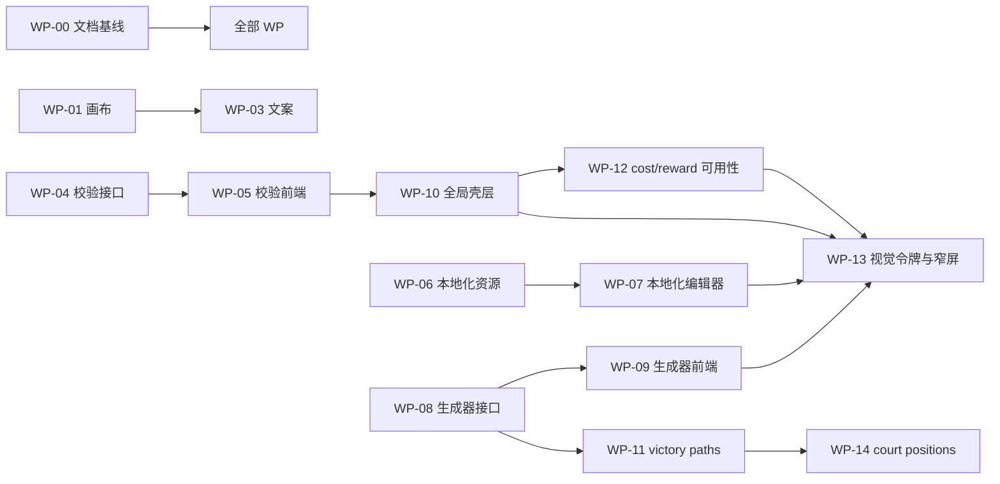

# Editor/Web 改进分工工作文档

> 本文件是**多 agent 并行开发的唯一工作来源**。状态快照见
> [Editor_Web_Refactor_Status.md](Editor_Web_Refactor_Status.md)，架构基线与理由见
> [Towards_Victory_Editor_Web_Assessment.md](Towards_Victory_Editor_Web_Assessment.md)。
> 状态文档的"当前焦点/后续任务"不再用于选题；选题以本文件的**工作包（WP）**为准。

## 0. 目的与依据

2026-10-12 评估结论（证据见"附录 A 事实清单"）：平台层（资源协议、锁、生命周期、生成 DAG、产物校验）
已完成且不需要重做；不匹配集中在三处——**编辑面与真实工作量倒挂**、**三处语义错配**（胜利树页面绑未实现设计稿、
`task_pool.yaml` 无消费方、校验规则不在工具链路）、**前端缺全局状态与工作台能力**。

用户已确认的决策（2026-10-12，不可自行推翻）：

| 事项 | 决定 |
| --- | --- |
| 胜利树页面 | **保持当前定位**（设计稿坐标摆放），只修标注与文案，不迁移到 `victory_paths.yaml` |
| `task_pool.yaml` | **继续维护**，不冻结编辑器 |
| 后端路线 | **逐域资源化**：按域新建资源，扩展统一资源协议，不另起一套模型 |
| 状态文档"后续任务 2/3"（跨资源 ChangeSet、完整输入依赖图、跨进程锁、同步/异步统一调度） | **关闭**，不再推进 |

## 1. 总体分工原则

1. **契约先行**：每个后端 WP 先在本文件第 6 章写下 payload 形状，再写实现；前端 WP 只读该章，不改契约。
2. **后端先合、前端后接**：同一 WP 对（04/05、06/07、08/09）后端包合并之后前端包才开工。
3. **共享文件串行**：`server.py`、`index.html`、`static/shared.js`、`static/resource_state.js`、
   `static/shared.css`、`static/editor_panel.js`、`scripts/run_editor_tests.py`、`README.md`、本文件
   由**一个 WP 独占一段时间**，按下表顺序合并；不接触这些文件的 WP 可全并行。
4. **一个 WP 一个 owner，一个 WP 一次提交（或一个连续小批）**，提交信息说明"WP 编号 + 交付物"。
5. **禁止跨包顺手重构**：例如修裁剪画布时不得顺带改主题层；不在 WP-03 里改数据语义。
6. **验收与实现分离**：优先由另一个 agent 按第 7 章的判据独立复跑；实现者自验通过不等于验收。

### 共享文件合并顺序（硬性）

```
WP-01(shared.js 加 tool-activated 事件)
  → WP-03(index.html 文案) → WP-05(index.html 容器 + shared.css)
  → WP-07(index.html 标签页) → WP-09(index.html 容器)
  → WP-10(shared.js / resource_state.js / index.html / shared.css 重组)
  → WP-12(static/*.js 文案与交互) → WP-13(shared.css 及全部 CSS)
后端 server.py 顺序：WP-04 → WP-06 → WP-08 → WP-11 → WP-14
```

任何 WP 不得修改其他 WP 正在独占的段落；冲突时排队，不各自合并。

## 2. 工作包总表

优先级：P0 = 关掉误导与缺陷，先做；P1 = 补最热的编辑面与全局壳层；P2/P3 = 打磨与剩余域。

| WP | 名称 | 归属 | 依赖 | 接触文件（主要） |
| --- | --- | --- | --- | --- |
| WP-00 | 流程与文档基线 | 文档 | — | 状态文档、`CLAUDE.md`、本文件 |
| WP-01 | 裁剪画布首屏空白 | 前端 | — | `static/cropper.js`、`static/shared.js` |
| WP-02 | meta 卡片值被截断 | 前端 | — | `static/wonder_localization.css` |
| WP-03 | 误导性文案与标注 | 前端 | WP-01 | `static/index.html`、`static/victory_tree.js`、`static/cost_reward.js` |
| WP-04 | 校验接口 | 后端 | — | `services/validation.py`(新)、`server.py`、`tests/test_validation_api.py`(新) |
| WP-05 | 校验结果前端 | 前端 | WP-04 | `static/validation_panel.js`(新)、`static/index.html`、`static/shared.css` |
| WP-06 | 非 Wonder 本地化资源 | 后端 | — | `services/localization_editor.py`(新)、`server.py`、契约测试(新) |
| WP-07 | 本地化编辑器页面 | 前端 | WP-06、WP-05 | `static/localization.js`/`.css`(新)、`static/localization_text.js`(新)、`static/index.html` |
| WP-08 | 生成器注册表与运行接口 | 后端 | — | `services/generator_runs.py`(新)、`server.py`、`data/generated_files.yaml` |
| WP-09 | 生成器前端 | 前端 | WP-08 | `static/generators.js`(新)、`static/index.html` |
| WP-10 | 全局壳层（脏点/操作面板/离开确认） | 前端 | WP-05 | `static/shared.js`、`static/operations_panel.js`(新)、`static/resource_state.js`、`static/index.html` |
| WP-11 | victory paths / tasks 资源化 | 后端+前端 | WP-08 | `services/victory_paths.py`(新)、`static/victory_paths.js`(新) |
| WP-12 | cost/reward 可用性（行级脏点/过滤） | 前端 | WP-10 | `static/cost_reward.js`、`static/cost_reward.css` |
| WP-13 | 视觉令牌统一与窄屏 | 前端 | WP-07/09/10/12 | `static/shared.css`、`cost_reward.css`、`victory_tree.css`、`workspace_theme.css` |
| WP-14 | court positions 资源化 | 后端+前端 | WP-08、WP-11 | `services/court_positions.py`(新)、前端新模块 |

### 依赖图



---

## 3. P0 工作包

### WP-00 流程与文档基线

**目标**：让并行领取成为合法流程，避免 agent 按旧规则"只推进当前焦点一项"而互相阻塞。

**交付物**
- 状态文档 `docs/technical/Editor_Web_Refactor_Status.md`：改写"使用规则"与"当前焦点"两节，
  指向本文件；"后续任务 2/3"改为**已关闭（用户 2026-10-12 决定）**并保留一句关闭理由；
  验证记录格式不变。
- 根 `CLAUDE.md`：启动阅读顺序加入本文件（`BRIEF.md` → 状态文档 → 本文件 → Web README）。
- 本文件：把"附录 A 事实清单"标为证据来源，避免后续 agent 重新调研。

**验收标准**
- `git grep -n "不要从「后续任务」中自选"` 在状态文档中不再出现；两文件互相链接可达。
- 若改动涉及 `docs/knowledge/` 下被 `gen_brief.py` 引用的文件，运行
  `python scripts/gen_brief.py` 后 `git diff` 只含预期内容。

### WP-01 裁剪画布首屏空白（前端，P0）

**现状（已核实）**：`draw()` 只在 `image.onload`、窗口 `resize`、指针拖动时调用
（`static/cropper.js:128,137,149`、`pointermove`）。标签页从 `display:none` 变可见不触发 `resize`，
`resizeCanvasToDisplay()` 取到 `getBoundingClientRect()` 为 0，画布停在 1×1，用户看到纯深色面板。

**交付物**
- `static/shared.js`：`activateTool()` 内派发 `document.dispatchEvent(new CustomEvent("tool-activated", { detail: { tool: toolName } }))`。
- `static/cropper.js`：监听 `tool-activated`，当 `detail.tool === "wonder-cropper"` 时调用 `draw()`；
  同时给 canvas 挂 `ResizeObserver` 以覆盖窗口以外的尺寸变化。

**验收标准（Chrome 子验收，加入 `--full` 层）**
- 新场景：刷新页面 → 直接点击"奇观裁剪"标签（**不点击"重新加载裁剪"**）→ 断言
  `canvas.width > 1 && canvas.height > 1`，且 1 秒内画布中心像素不是背景色 `#0f1115`。
- 反向验证：把 `tool-activated` 监听撤掉后该断言必须失败（记录在验证记录中）。
- 现有 `node tests/resource_state_browser.cjs` 全量仍通过。

### WP-02 meta 卡片值被截断（前端，P0）

**现状（已核实）**：`static/wonder_localization.css:427-439` 的 `.meta-card` 只给 `span` 定了样式，
`strong` 没有 `overflow-wrap`；`.meta-grid` 用 `minmax(150px,1fr)`，长 key 溢出并与相邻卡片重叠。

**交付物**：`.meta-card strong { overflow-wrap: anywhere; }`（必要时加
`word-break: break-word`），保持既有网格与视觉不变。

**验收标准**
- Chrome 断言：选择 key 最长的奇观后，每个 `.meta-card strong` 满足
  `scrollWidth <= clientWidth + 1`，且相邻 `.meta-card` 的 `getBoundingClientRect()` 互不交叠。
- 截图对比 1600px 与 1000px 两个宽度（截图存仓库外临时目录，不入库）。

### WP-03 误导性文案与标注（前端，P0）

**三条已确认的错配**（证据见附录 A）

1. 胜利树页面：`data/victory_path_tree_variant.yaml` 自述"design record, NOT YET IMPLEMENTED …
   do not merge them"；`save_positions()` 不调用 `run_generation`（`services/victory_tree.py:302`），
   而按钮文案是"保存并重新生成"（`static/index.html:89`）。
2. `task_pool.yaml` 文件头："Nothing in the mod reads from this catalog yet"。
3. 媒体工具中需要 API key / 会产生费用的工具有 5 个可运行项，UI 未提示。

**交付物（仅文案与标注，不改行为、不改数据语义）**
- 胜利树页头加一行说明："设计稿（未实现），仅用于摆放坐标；不参与游戏当前系统"；
  按钮改为"保存坐标"；`victory_tree.js` 内相关提示同步。
- cost/reward 页 `task_pool` 两个分类页头加一行："当前无机制消费此目录（见
  `docs/design/Cost_Reward_Unit_Concepts.md` 第 6 节）"。
- 媒体工具：在需要付费 API 的工具卡上加徽标（付费）、在本地确定性工具上加徽标（本地）。徽标文案来源
  建议由 `ToolSpec` 增加一个 `cost_hint` 字段承载，而不是在 JS 里硬编码 id 列表；若采用该方案，
  `services/tooling.py` 的 `ToolSpec` 变更属于本 WP（属后端小改，需在提交信息中说明）。

**验收标准**
- Chrome 断言三处文案存在（用 `innerText` 包含判断），且胜利树页面不存在含"重新生成"的保存按钮文案。
- `python -m towards_victory_editor_web --check` 输出与改动前一致（本 WP 不改检查逻辑）。

---

## 4. P1 工作包

### WP-04 校验接口（后端）

**目标**：把 `scripts/validate.py` 接进工具链路。这是 `CLAUDE.md` 规定的提交前必跑步骤，目前浏览器路径完全没有它。

**交付物**
- `services/validation.py`：以 `subprocess` 调用 `[sys.executable, REPO_ROOT/"scripts"/"validate.py", ...]`，
  传 `--ai-report`，解析 stdout JSON（契约见 6.1）。禁止 `conda run`；用 `sys.executable`。
- `server.py`：新增 `POST /api/validate`。
- `tests/test_validation_api.py`：覆盖路径白名单、`pass:false` 仍返回 200、超时、非 JSON 输出、
  仓外路径拒绝。

**安全性要求（硬性）**
- `files` 只接受 `data/`、`src*/`、`scripts*/` 下的仓库相对路径；解析后必须仍在 `REPO_ROOT` 内，
  否则 400。
- 默认不传 `--fix`；`fix` 仅当显式 `true` 且调用方来自本机工具时可用，并在响应中回显 `fixed` 列表。
- 单次调用超时 180 秒，超时返回 504 并附已捕获输出。

**验收标准**
- pytest：`tests/test_validation_api.py` 全绿，其中含一条"故意写入重复 loc key 的临时仓库副本 →
  `pass:false` 且 errors 中含 `[LOC]`"的用例。
- 手工：`curl -X POST /api/validate -d '{"changed":true}'` 在干净工作区返回 `pass:true`。
- 记录单次壁钟耗时（对照 `--changed` 的现有 CLI 耗时）。

### WP-05 校验结果前端（前端，依赖 WP-04）

**交付物**
- `static/validation_panel.js`（新）：三态渲染（pass / errors / warnings），错误按 `rule`
  分组，支持复制；`errors[].file` 存在时渲染为可点击文本（跳转能力由 WP-10/后续统一，本期先渲染为可复制文本）。
- `static/index.html`：底部加容器 `#validation-panel`；`static/shared.css` 加样式段。
- 触发点：在各工具保存成功后自动调用一次 `POST /api/validate`（`changed:true`），
  并提供手动"校验当前改动"按钮。

**交接规则**：后端契约变更必须先改 6.1 再改前端。

**验收标准**
- Node 单测（`tests/validation_panel.cjs`，新，注册进 `run_editor_tests.py` 的 `NODE_FILES`）：
  注入假 fetch，断言三种响应渲染出对应文案与错误条数。
- Chrome 子验收：保存一次（用只读预览 + 拦截，不写真实文件；真实写入由 pytest 临时副本覆盖）→
  断言校验面板出现结果；再造一个 errors 响应，断言红色态与错误条目。

### WP-06 非 Wonder 本地化资源（后端）

**目标**：覆盖最热的零工具手写面。规则（写进资源描述，不硬编码清单）：
`src*/**/localization/**/*.yml` 中**不在** `data/generated_files.yaml` 的 `output` 里的文件。

按当前仓库状态，命中 **12 个手写文件**：`src`(8) + `src_engineering_department`(4)。
`src` 的 5 个生成文件、`src_court_positions` 的 1 个生成文件**只读展示**并给出"应改其 data 源"的提示
（决策：默认只读，理由是编辑会被下一次生成覆盖；该决策可在评审时推翻）。

**交付物**
- `services/localization_editor.py`（新；注意与 `services/wonder/localization.py` 区分命名）。
- 端点：`GET /api/resources/editor.localization` 与 `POST .../{validate,preview,commit}`（6.2）。
- `tests/test_localization_resource_contract.py`（新）：固定样本 + 真实临时副本。
- `--check` 增加一节：手写 loc 文件数、EN/ZH 键数、缺失键数（复用 `check_loc_coverage` 的比对逻辑，
  按 mod root）。

**行级编辑语义（必须在实现前写进 6.2）**
- 新增键：必须同时提供 `english` 与 `simp_chinese` 值，否则 validate 拒绝（防止制造缺译）。
- 删除键：同时删除两语言条目。
- 值变更：保留文件头注释、BOM（`utf-8-sig`）与既有换行符；正文分节注释与引号按现有 `yaml_bytes`
  行为（已接受限制，不扩大范围）。

**验收标准**
- 契约测试覆盖：加载（文件清单与 generated 排除规则）、字段级 diff、缺译报告（人为删一个 zh 键 →
  preview 中列为缺失，validate 拒绝）、重复键拒绝、BOM/换行保留、base 冲突 409、写入失败恢复。
- 生成物文件在 draft 中标记 `read_only: true`，commit 尝试修改时返回 400 并给出源 data 路径提示。
- `python -m towards_victory_editor_web --check` 输出新增一节且通过。

### WP-07 本地化编辑器页面（前端，依赖 WP-06）

**交付物**
- `static/localization.js` + `static/localization.css`（新标签页"本地化"）。
- `static/localization_text.js`（新，共享渲染器）：把 loc 文本渲染为游戏内近似预览——
  `#G/#R/#Y/#!` 段落色、`$var$`/`$var$` 变量、`[x|e]` 函数、`\n` 换行。**必须写明支持与不支持范围**
  （例如不支持 `@icon!` 贴图与自定义 loc 函数展开），避免假装完整。
- 双列 EN/ZH、缺译高亮、过滤（全部 / 仅缺译 / 仅已改动）、搜索、`Ctrl+S`，
  走 `editor_panel.createEditorPanel` + `resource_state`（复用现有冻结/预览/确认流程）。

**验收标准**
- Node 单测（`tests/localization_text.cjs`，新）：`#Gfoo#!`、`$X$`、`[trust|e]`、`\n`、
  未闭合标记的降级行为各一条。
- Node 单测（`tests/localization.cjs`，新）：过滤与缺译统计、新增键必须双语言。
- Chrome 子验收：进入标签页 → 选中一个文件 → 双列存在 → 改一个 zh 值 → 标签栏脏点出现（依赖 WP-10，
  若 WP-10 未合则断言页内 dirty 徽标）→ 预览对话框列出该键。

### WP-08 生成器注册表与运行接口（后端）

**背景**：`data/generated_files.yaml` 登记 114 个脚本（142 条 output），工具只引用 38 个，
**76 个只能从 CLI 跑**。本 WP 把它们变成可点运行，但**不建依赖 DAG**（决策：通用面板是顺序执行，
域内依赖仍由各域资源负责，例如 Wonder 的 DAG）。

**交付物**
- `GET /api/generators`：从 `data/generated_files.yaml` 解析 → 按 `scripts*` 目录的 root/域分组，
  返回 `{script, root, domain, data_inputs[], outputs[]}`。
- `POST /api/generators/run`（6.3）：复用 `platform.run_operation` + `artifacts.py` 的文件级产物校验，
  返回 operation 快照、逐步退出码与耗时、产物清单。
- `services/generator_runs.py`（新）。
- 把 `scripts/gen_index.py` 的 7 个输出登记进 `data/generated_files.yaml`（当前缺失，导致
  `validate.py` 的 generated 检查与 `gen_brief.py` 的 codegen 表都不覆盖它）。
- 顺带补齐媒体 handler 的资源依赖声明：`media.historical_style`、`media.historical_api`、
  `media.dds_icon` 三者目前只声明文件与格式，按实际读写的编辑资源补 `resource_ids`。

**安全与一致性（硬性规则）**
- 只允许运行 `data/generated_files.yaml` 中登记的脚本；未知脚本 400。
- 同一次请求内**输出路径相交的脚本集合拒绝**（400，附冲突路径），不做隐式排序。
- 每步超时 120 秒（沿用现有约定），超时终止并报告已捕获输出。
- 仅在本进程持有的资源锁内执行；`resource_ids` 由脚本输出所属域推导，未识别时只持文件级快照。
- 不写 staging 之外未声明的文件；产物校验是**文件级**（PNG/DDS/JPEG/JSON 与文本格式），
  不得在文档或 UI 中宣称为领域语义校验。

**验收标准**
- pytest（`tests/test_generator_runs.py`，新，进 `PYTEST_FILES`）：
  临时仓库副本中运行一个真实小生成器并逐字节对比产物；未知脚本、输出相交、未登记产物、
  非零退出、超时各一条；拒绝后工作区无写入。
- `--check` 增加一节：可运行生成器总数与分组计数。
- 与 `python scripts/validate.py --changed --ai-report` 联合验证：运行一个生成器后该脚本的
  generated-header 检查仍通过。

### WP-09 生成器前端（前端，依赖 WP-08）

**交付物**：新增"生成器"标签页（或媒体工作台内的独立分组，二选一由 owner 决定并记录）：
按域分组的脚本列表、多选、运行、逐步结果与产物报告、明确的"顺序执行、无依赖图"说明。
复用 `job_panel`/`display.formatOperationReport` 的既有渲染。

**验收标准**
- Node 单测：分组渲染、选择与禁用态、结果报告字段映射。
- Chrome 子验收：`dry_run` 模式或只读取列表（**真实执行会写 src，Chrome 场景不得调用真实写入**；
  真实执行由 WP-08 的 pytest 临时副本覆盖）→ 断言行前/中断态/错误态渲染。

### WP-10 全局壳层（前端，依赖 WP-05）

**交付物**
- `static/shared.js`：在 WP-01 的 `tool-activated` 之上增加标签栏**脏点**与**作业指示**；
  `beforeunload` 离开确认汇总所有工具的脏状态。
- `static/operations_panel.js`（新）：轮询 `GET /api/operations?limit=25`（端点已存在，前端从未调用），
  展示最近操作、在跑作业、失败项，可展开 `GET /api/operations/{id}`。
- `static/resource_state.js`：增加 `onDirtyChange` 回调（共享文件，本 WP 独占），
  由四个编辑器注册；cost/reward 与 victory tree 目前完全不渲染脏状态（已核实 `grep dirty` 无匹配）。
- `static/index.html`：页头加操作面板容器，标签栏加指示点。

**验收标准**
- Node 单测（`tests/global_shell.cjs`，新）：脏点注册表增删、重复事件去重、操作列表三态渲染。
- Chrome 子验收：在 cost/reward 改一个字段 → 切到其他标签 → 标签栏出现脏点；构造一个假 job
  轮询响应 → 操作面板出现该项；`beforeunload` 在有脏状态时被阻止（断言监听器行为）。

### WP-11 victory paths / tasks 资源化（后端+前端，依赖 WP-08）

**目标**：逐域资源化最热的手写主线之一。`data/victory_paths.yaml`（全史 59 次提交）与
`data/victory_path_tasks.yaml`（77 任务，12 个生成器消费）目前零编辑器。

**边界（不得越界）**
- 资源 = `data/victory_paths.yaml` + `data/victory_path_tasks.yaml`。
- **不含** `data/victory_path_tree_variant.yaml`（用户已决定胜利树保持现状）。
- **不含** `data/task_pool.yaml`（与 victory tasks 无引用关系，已核实）。

**必做的前置设计（写入提交信息与状态文档验证记录）**
1. 资源边界与字段模型：路径 / 里程碑 / 三槽任务 / 奖励引用（奖励值来自 cost/reward 目录时如何引用）。
2. 生成根：`scripts/gen_victory.py` 的 14 个产物 + 下游（GUI/leaderboard/actions/CMF）——
   必须用 WP-08 的生成器注册表描述依赖，禁止再硬编码脚本元组。
3. 与 cost/reward 的交叉影响（奖励目录变更）如何避免假冲突：沿用现有 `written_paths` +
   `refreshKeepingDrafts` 机制，不新增跨资源事务。

**验收标准**
- 契约测试（`tests/test_victory_paths_resource_contract.py`，新）：加载、字段 diff、base 冲突、
  生成失败恢复、生成计划选择。
- 临时副本中运行受影响生成器并**逐字节对比产物**（放进 `slow` 标记，只跑 `--full`）。
- Chrome 子验收：加载 → 改一个里程碑字段 → 预览 diff 列出该字段 → 取消后草稿保留。

---

## 5. P2/P3 工作包

### WP-12 cost/reward 可用性（前端，依赖 WP-10）

现状（实测）：modifier 表 395 行一次渲染约 2.5 s、页面高 18599 px；无行级脏标记、无过滤、无
"仅显示改动"；`value` 无单位说明。

**交付物**：行级 dirty 样式（改动行着色 + 顶部"已改动 N 行"）、过滤框（id/loc 文本）、
"仅显示已改动"开关、`value` 列补单位/说明（来源为数据文件注释，需 owner 核对，不得凭空编造）、
任务池表的 `scope`/`completion_note` 长文本支持展开与复制。

**验收标准**
- Node 单测：过滤与"仅改动"逻辑、dirty 行集合计算。
- Chrome 子验收：改 2 个值 → 断言 2 行着色、计数为 2、切"仅改动"后行数为 2。
- 性能回归：395 行渲染耗时上限写入断言（基线实测约 2.5 s，目标不高于基线）。

### WP-13 视觉令牌统一与窄屏（前端，最后做）

现状：`shared.css`（深色）→ `cost_reward.css`/`victory_tree.css`（深色）→ `workspace_theme.css`
（米色，且 `color-scheme: light` 静默关闭深色模式）→ `wonder_localization.css`（1348 行，自带一套同值
不同前缀的令牌）；主按钮颜色、圆角（奇观胶囊 vs 其余 10 px）、日志色都依赖 link 顺序。
`@media` 全项目仅 4 处；`victory_tree.css:170` 的 `aside{width:300px}` 无断点，390 px 下画布塌成约 40 px。

**交付物**：单一令牌层（合并 `:root/body/button` 规则到一处，删除重复定义）；统一按钮形状与
语言标签（`English/简体中文/Mechanics/仪式设计` 目前中英混排）；`victory_tree.css` 窄屏断点；
`shared.css` 明确 `color-scheme` 取值。

**验收标准**
- 断言只有一个文件定义颜色令牌（脚本或 grep 检查，写入测试）。
- Chrome 截图矩阵：1600 / 1000 / 390 px × 5 个标签，断言
  `document.documentElement.scrollWidth <= clientWidth + 1`（无横向滚动），
  且胜利树在 390 px 下画布宽度 ≥ 300 px。
- 视觉回归以截图人工比对为判据并记录在验证记录中（本项目无像素级基线，不新增图像 diff 工具）。

### WP-14 court positions 资源化（后端+前端，候选）

`src_court_positions` 是独立可部署根，`data/court_positions.yaml` 驱动 10 个生成器，当前零覆盖。
按 WP-11 的同一模式做；`src_eureka` 目前只有脚手架，**不在范围内**。

---

## 6. 接口契约（后端 WP 合并前必须填写本节；前端 WP 只读）

### 6.1 `POST /api/validate`（WP-04）

```json
// 请求
{ "files": ["data/unique_wonders.yaml"], "changed": false, "fix": false }
// files 省略且 changed 省略时等价 --changed
// 响应（HTTP 200，即使 pass=false）
{
  "pass": false,
  "errors":   [{ "rule": "...", "message": "...", "file": "data/x.yaml", "line": 12 }],
  "warnings": [{ "rule": "...", "message": "..." }],
  "files_checked": 3,
  "command": ["...", "scripts/validate.py", "--ai-report"],
  "duration_ms": 1234,
  "fixed": []
}
```
400：路径越界或不在白名单；504：超时（附 `output_tail`）。

### 6.2 `editor.localization` 资源（WP-06）

```json
// GET /api/resources/editor.localization → resource + draft + change_set（沿用现有三件套）
// draft
{
  "roots": [
    { "root": "src", "files": [
      { "path": "src/main_menu/localization/english/tv_game_concepts_l_english.yml",
        "read_only": false,
        "languages": { "english": [{ "key": "k", "value": "v" }],
                       "simp_chinese": [{ "key": "k", "value": "v" }] } }
    ]}
  ],
  "missing_translations": [{ "path": "...", "keys": ["k1", "k2"] }]
}
// commit/preview edits
{ "edits": { "<path>": { "k1": { "english": "text", "simp_chinese": "文本" } } },
  "base": { "<path>": "<sha256>" } }
```
新增键缺任一语言 → 400；`read_only` 文件出现在 edits → 400 并给源 data 路径。

### 6.3 `/api/generators`（WP-08）

```json
// GET → { "generators": [{ "script": "scripts/gen_victory.py", "root": "src",
//   "domain": "victory", "data_inputs": ["data/victory_paths.yaml"],
//   "outputs": ["src/in_game/.../towards_victory_triggers.txt"] }] }
// POST /api/generators/run
{ "scripts": ["scripts/gen_victory.py"], "dry_run": false }
// 响应
{ "operation_id": "...", "operation": { ... },
  "results": [{ "script": "...", "status": "succeeded", "exit_code": 0,
                "duration_ms": 8123, "output_tail": "..." }],
  "artifacts": [{ "path": "...", "size": 0, "sha256": "...", "changed": true }],
  "rollback": { "status": "not_needed", "errors": [] } }
```
400：未知脚本 / 请求集合内输出路径相交 / 产物未登记。

---

## 7. 统一验收标准（每个 WP 都必须给出）

1. **命令与结果**：给出实际运行的命令与通过数、耗时摘要，写入状态文档"验证记录"对应小节
   （沿用现有格式，不新增按提交排列的历史日志）。
2. **测试注册**：新增 pytest 文件加入 `scripts/run_editor_tests.py` 的 `PYTEST_FILES`；
   新增 Node 文件加入 `NODE_FILES`；Chrome 子验收从 `tests/resource_state_browser.cjs` 以
   `require` 挂载（现有 `wonder_fields_browser.cjs` 等即此模式）。
3. **分层**：真实生成器逐字节比对等重测试标记 `slow`，只在 `--full` 跑。
4. **反向验证**：至少一条"撤掉本修复后断言必须失败"的证据（P0 与涉及并发/恢复的 WP 必须有）。
5. **不写真实业务文件**：Chrome 场景用只读接口与拦截；真实文件写入只允许在临时仓库副本中进行。
   验收后清理仓库根的 `.pytest-*` 目录。
6. **必跑集合**（其中"本节相关文件"由各 WP 自行列出）：

```powershell
C:/Users/Hades/anaconda3/envs/eu5/python.exe scripts/run_editor_tests.py            # 默认层
C:/Users/Hades/anaconda3/envs/eu5/python.exe scripts/run_editor_tests.py --full     # 改生成器/前端后必跑
C:/Users/Hades/anaconda3/envs/eu5/python.exe scripts/validate.py --changed --fix --ai-report
git diff --check
```

7. **文档同步**：改前端或生成器后更新 `towards_victory_editor_web/README.md`；
   改知识/流程文件后按 `CLAUDE.md` 重新生成 `BRIEF.md`；状态文档在同一提交内更新完成状态。

## 8. 领取流程（agent 视角）

1. 读 `CLAUDE.md` → `docs/knowledge/BRIEF.md` → 状态文档 → 本文件。
2. 选一个**依赖已满足**的 WP（见依赖图与共享文件合并顺序），在提交信息中写 WP 编号。
3. 跑 `python scripts/ai_context.py --files <目标文件>` 取得风险卡与生成归属。
4. 写实现前先确认第 6 章契约（后端：先写契约再写码；前端：只读契约）。
5. 按第 7 章自验并产出证据，交给另一个 agent 独立复跑。
6. 更新状态文档的焦点进度与验证记录。

跨工具派单（Claude Code ↔ Codex）的调用形态与硬性规则见第 10 章；批次顺序见
[批次交接](Editor_Web_Handoff_2026-10-12.md)。

## 9. 本方案明确不做

- **不重做** platform 资源协议、`run_operation`、OperationStore、Wonder 生成 DAG、`artifacts` 检查。
- **不做**跨资源 ChangeSet、完整输入依赖图、跨进程持久锁、同步/异步统一调度（原"后续任务 2/3"，用户已关闭）。
- **不迁移** Wonder 已完成的领域拆分；不为胜利树换资源模型。
- **不引入**前端框架、构建步骤、CSS 预处理器或图像 diff 工具。
- **不保留**旧内部 schema 的兼容分支（项目未发布，按 `CLAUDE.md` 规则直接替换）。
- **不扩写**状态文档的"已接受限制"；新发现问题记入独立待办（一行一条）。

## 10. 跨工具协作（Claude Code ↔ Codex）

2026-10-12 在本机实测：`codex-cli 0.154.0`、`claude 2.1.296`；两个方向都通过 shell 子进程可用。

| 通道 | 方向 | 状态 |
| --- | --- | --- |
| `codex exec` 无头执行 | Claude → Codex | 已验证（`--sandbox read-only` 冒烟返回 0，并正确加载了 `CLAUDE.md`） |
| `claude -p` 无头执行 | Codex → Claude | 已验证（`--bare -p` 正常输出） |
| `claude mcp serve` + `codex mcp add` | Claude → Codex（MCP 形态） | 可选，单向。`codex mcp` 只有客户端命令，**没有 `codex mcp-server`**，Codex 不能作为 MCP 服务端被挂载 |
| Codex app-server / `codex agents` | — | 仅 Codex 内部，不涉及 Claude Code |

### 10.1 标准调用形态

派给 Codex（一次调用 = 一个完整 WP）：

```bash
codex exec -C . --sandbox workspace-write \
  --output-last-message .editor_state/handoff/<WP>.md --json \
  "<第 10.2 节的派单模板>"
```

交给 Claude Code（一次调用 = 一次验收复跑）：

```bash
claude -p "<验收指令>" --allowedTools "Bash,Read,Grep,Glob" --add-dir .
```

- `--output-last-message` / `-o` 把最终消息落到文件，父 agent 读文件即可，不去解析 stdout 尾部。
- 报告写到 `.editor_state/handoff/`（该目录已被 Git 忽略），不污染 `git status`。
- Codex 侧没有 `AGENTS.md` 时直接读 `CLAUDE.md`（实测确认），本项目规则因此自动继承；
  只有需要让 Codex 走不同规则时才新增 `AGENTS.md`。

### 10.2 硬性规则

1. **只能父调子一层。** 子进程不得再派发同级或父级 agent；发现被要求二次派发时，停止并报告。
2. **共享文件同时只允许一个 owner。** 见第 2 章的合并顺序；并行 WP 建议各自开 worktree。
3. **产出即数据，不是批准。** 任何 agent 自述"验收通过"都不构成用户批准，也不构成验收通过；
   按第 7 章由另一个 agent 复跑命令为准。子 agent 无权批准权限变更、配置修改或待确认动作。
4. **不派碎活。** 每次调用都要覆盖一个完整 WP 或一次完整审查——两个 CLI 都会重新加载项目上下文，成本与耗时不可忽略。
5. **验收者与实现者不同。** 默认：Codex 实现 → Claude 复跑验收；如反方向，同样成立。
6. **越界即停。** 实现中若发现需要改动第 6 章契约、跨 WP 重构或触及第 9 章"不做"清单，
   停止并在报告中标出，不要自行扩权。

## 附录 A 事实清单（评估证据，供后续 agent 复核）

> **证据来源。** 本表是 2026-10-12 评估的唯一证据来源，各 WP 的“现状（已核实）”均引用此处。
> 领取 WP 时直接以本表为准，只在动手前按“证据”列复核与本 WP 相关的条目；**不要重新做全面调研**。
> 若复核发现事实已变化，在本表对应行更新并在报告中说明，而不是另起调研文档。

| 事实 | 证据 |
| --- | --- |
| 近 4 个月 1,002 次提交；工具覆盖的四份数据合计 14 次（cost_reward_units 5、task_pool 3、node_positions 3、image_crops 3） | `git log --since=2026-06-01 --oneline -- <file> \| wc -l` |
| `wonder_localization.yaml` 66（71）、`unique_wonders.yaml` 41（45） | 同上 |
| 最热手写面：`tv_engineering_department.gui` 121、`tv_engineering_department_l` 40、`tv_game_concepts` 24、`tv_govhouse` 21 | 同上 |
| `generated_files.yaml` 登记 142 条 / 114 脚本，工具引用 38 → 76 个 CLI-only | `data/generated_files.yaml` + `grep -r` 于 `services/wonder_generation.py`/`generation.py` |
| 胜利树绑定未实现设计稿 | `data/victory_path_tree_variant.yaml:1-9` |
| 胜利树保存不触发生成 | `services/victory_tree.py:302` `save_positions()`；`static/index.html:89` 按钮文案 |
| `task_pool.yaml` 无消费方 | `data/task_pool.yaml:1-9`；全仓引用仅 `services/cost_reward.py:43` |
| 浏览器不跑 validate.py | `server.py` 无该引用；`grep validate static/*.js` 仅提示文案 |
| `/api/operations` 端点已存在但前端未调用 | `server.py:312,320`；`grep api/operations static/` 无匹配 |
| 12 个手写 loc 文件（src 8 + 独立根 4） | `ls src*/main_menu/localization/english` 与 `generated_files.yaml` 的 output 求差 |
| 裁剪画布首屏空白 | `static/cropper.js:128,137,149`（draw 触发点），标签切换不触发 resize |
| `.meta-card strong` 无换行规则 | `static/wonder_localization.css:427-439` |
| 脏状态仅 Wonder 渲染 | `grep dirty static/*.js` 无 cost_reward/victory_tree 匹配 |
| Chrome 验收由 `resource_state_browser.cjs` require 四个子脚本 | `tests/resource_state_browser.cjs:196,260,261` |
